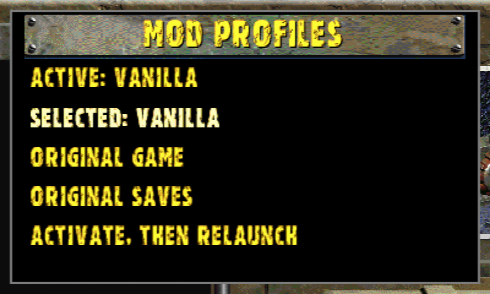
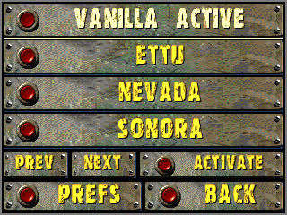
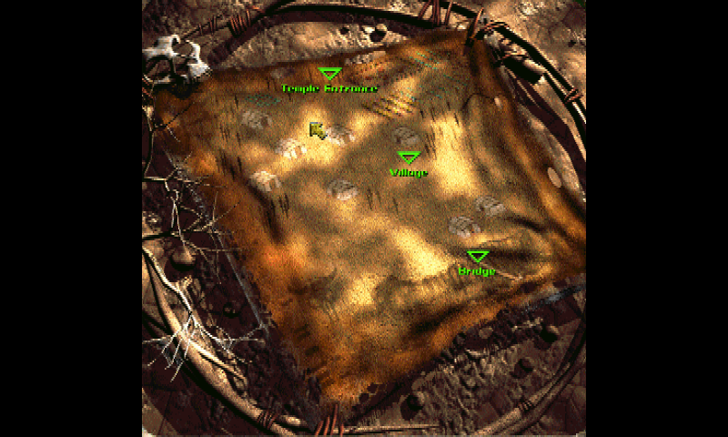
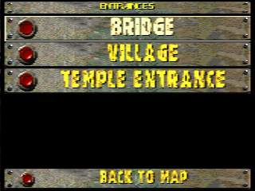
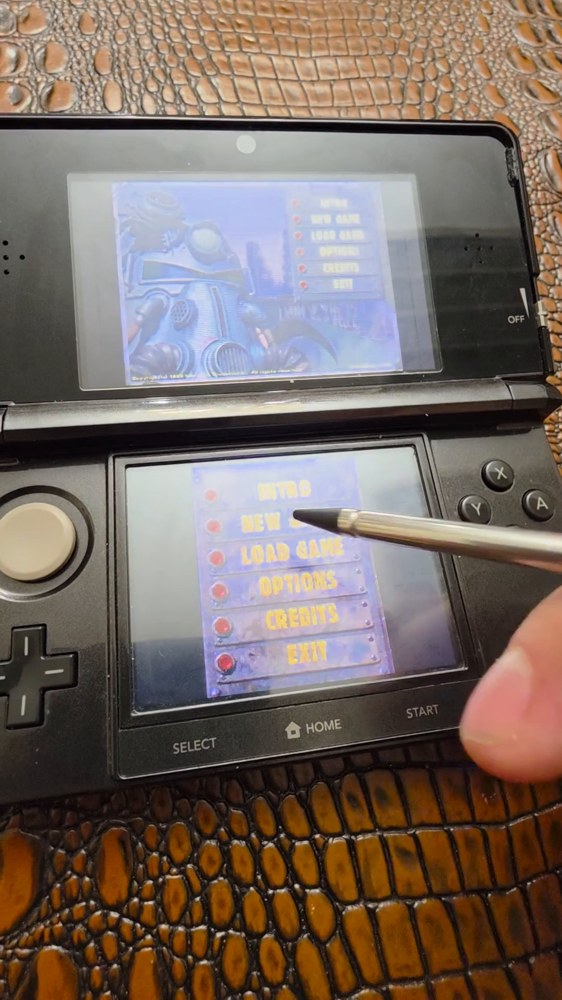
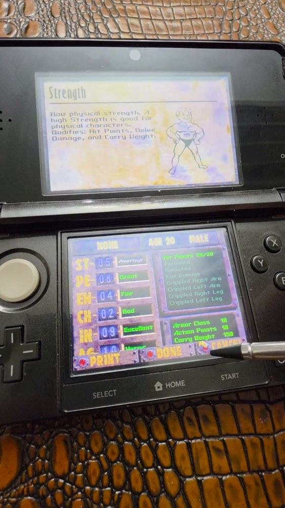
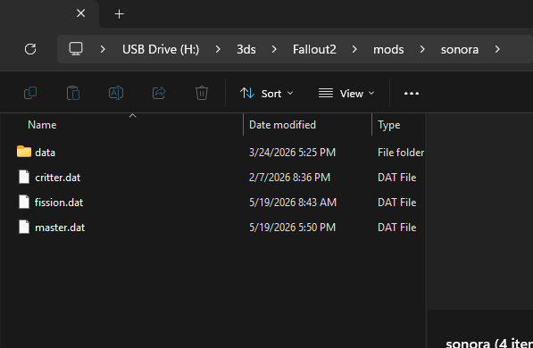
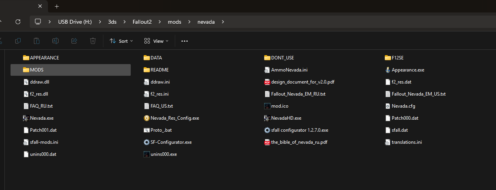

# Fallout 2 Community Edition — 3DS Enhanced

An unofficial enhanced fork of [MrHuu's Nintendo 3DS port](https://github.com/MrHuu/fallout2-ce-3ds) of [Fallout 2 Community Edition](https://github.com/alexbatalov/fallout2-ce). Focused on Old Nintendo 3DS performance, dual-screen layouts, touch controls and experimental mod compatibility while retaining original Fallout 2 gameplay.

**Latest beta: v2.0 Beta 1** — based on Alpha 17. [Release downloads (CIA and 3DSX)](https://github.com/Nookitlicious/fallout2-ce-3ds/releases).

Previous release: [v1.1.1 Beta](https://github.com/Nookitlicious/fallout2-ce-3ds/releases). Back up your saves before updating or trying mods. A legally obtained copy of Fallout 2 is required; original game data is not included.

## Screenshots

Original screenshots from the current development build (no generated artwork). The top and bottom screens are shown side by side for each interface.

**Mod profile manager**

<p>
  
  
</p>

**Town entrance selection**

<p>
  
  
</p>

<details>
<summary>Earlier hardware screenshots</summary>

<p>
  
  
  
</p>

</details>

## What's new in v2.0 Beta 1

This release consolidates the v1.1 improvements and the v1.2 Alpha 1–17 development cycle. Alpha 17 is the tested gameplay baseline; this beta packages that baseline with updated release documentation.

### Dual-screen interface and controls

- Full-width main-menu power armor artwork with dedicated bottom-screen menu buttons.
- Original Fallout-style metal menus, red indicator lights and larger readable buttons for mod profiles and town entrances.
- Improved dialogue layout, reply text clipping, touch response selection and dialogue review controls.
- Adapted inventory, item use, looting, barter, Skilldex, character creation, perks and Automap layouts.
- Improved character Options and character save/load dialogs; D-pad scrolling and B to dismiss dialogs.
- Dedicated Pip-Boy controls and content layout, automatic cursor placement, Circle Pad/D-pad navigation and touch controls.
- Improved save/load panels, status messages, software keyboard input, character names and save descriptions.
- Interface restoration improvements after movies, map transitions and encounters.

### World and town maps

- Enlarged destination list with readable names and larger touch targets.
- Dedicated top-screen map and bottom-screen destination controls; SELECT swaps the displays.
- D-pad now pans the world map in all four directions, with continuous scrolling when held. It no longer navigates the destination list in the world map view.
- Circle Pad moves the cursor across the map and controls; touch selects destinations. A/R selects, X enters a known location or toggles town entrances, and Y switches Town/World views.
- Free exploration of unknown areas, more reliable selection of nearby known locations and manual entry rather than automatic entry on approach.
- Dedicated town entrance menu with selectable entrance names, corresponding map markers and a return-to-map button.
- Fallback to configured city names when localized labels are missing.

### Old 3DS performance and stability

- Rendering, artwork caching, map loading, saving/loading and memory-management optimizations developed for Old 3DS.
- Reduced unnecessary processing, artwork/heap safety checks and improved GPU and shutdown cleanup.
- Map-transition graphical corruption fixes; the earlier loading overlay was removed.
- Optional gameplay, loading, menu and rendering profiling tools for diagnosing performance regressions.
- Improvements to party handling, lighting and mod startup diagnostics; full regression coverage remains incomplete.

### Experimental mod support

- Built-in mod-profile selector with paginated lists, active profile indication, activation/relaunch flow and separate profile saves.
- Shared base game archives when applicable; mod-specific archives, configuration and directory-based resource loading.
- Vanilla recovery after incomplete mod startup and improved archive/startup diagnostics.
- Initial compatibility with Unofficial Patch Updated, Fallout: Nevada Extended, Fallout et tu and Fallout: Sonora.
- Et tu directory-based loading, character creation and world map fixes; native Sfall movie filename replacements for the original 17 movie slots.
- Partial native Sfall support; Windows DLLs, complete scripting hooks, expanded movie slots, blank movie entries and subtitle compatibility are not guaranteed.

### Testing status

- Alpha 15/16: all 31 submitted interface, navigation, performance and stability checks passed.
- Alpha 17: maintainer reported world map control tests passed and Fallout et tu and Sonora working on physical Old 3DS hardware.
- No new crashes, freezes or save issues reported in those checklist tests. This does not establish that all prior Old 3DS crashes are fixed.
- Host world map layout test still fails a touch-coordinate assertion; its cause is unresolved despite successful hardware testing.
- Full campaigns, all console variants, separate 3DSX testing and exhaustive mod compatibility remain unverified for this beta.

## Controls Guide

### Normal Gameplay

| Button | Function |
|---|---|
| Circle Pad | Move cursor |
| C-stick (New models) | Move cursor |
| D-pad | Scroll gameplay view |
| R | Left-click / Move / Interact |
| L | Right-click / Change cursor mode |
| A / ZL | Switch gameplay and interface focus |
| SELECT | Cycle display layouts |
| SELECT + Up | Zoom in |
| SELECT + Down | Zoom out |
| 3D slider | Adjust gameplay scale |
| Touchscreen | Interact with interface buttons |

### World Map

| Button | Function |
|---|---|
| D-pad | Pan map in all four directions |
| Circle Pad | Move cursor |
| A / R | Select destination |
| X | Enter current location / Toggle entrances |
| Y | Switch Town and World maps |
| SELECT | Swap screens |
| Touchscreen | Select destinations |

### Town Entrances

| Button | Function |
|---|---|
| D-pad Up / Down | Select entrance |
| D-pad Left / Right | Change page |
| A | Confirm selection |
| B / X | Return to map |
| Touchscreen | Select entrance |

### Pip-Boy

| Button | Function |
|---|---|
| Circle Pad / D-pad | Move cursor |
| A / R | Select |
| Touchscreen | Interact |

### Character Screen and Dialogue

| Button | Function |
|---|---|
| D-pad Up / Down | Scroll |
| R | Left-click on character screen |
| L | Right-click on character screen |
| A | Confirm character dialogs |
| B | Close character dialogs / Dialogue review |
| Touchscreen | Select buttons and responses |


## Installation on Nintendo 3DS

You need a 3DS capable of running homebrew, an SD card and your own copy of Fallout 2 ([GOG](https://www.gog.com/game/fallout_2), [Steam](https://store.steampowered.com/app/38410/) or another legitimate distribution).

1. Install Fallout 2 on your PC and locate its game data.
2. Create `3ds/fallout2/` at the root of your SD card. Copy `master.dat`, `critter.dat`, `patch000.dat` (if present), the `data/` directory and any separate `sound/` directory from your installed copy. Keep a backup of your original files and saves. If copying `fallout2.cfg`, use relative paths instead of PC-specific absolute paths.
3. Download the desired CIA or 3DSX from the [Releases page](https://github.com/Nookitlicious/fallout2-ce-3ds/releases). Choose v2.0 Beta 1 for the latest beta and experimental mod support.
4. For CIA, copy it to your SD card and install using FBI on a compatible homebrew-enabled system. Launch from the HOME Menu. For 3DSX, copy the downloaded 3DSX (rename it to `fallout2-ce.3dsx`) into `3ds/fallout2/` and launch it through the Homebrew Launcher.

Example SD card layout (`sd:/` means the root of the SD card):

```text
sd:/
└── 3ds/
    └── fallout2/
        ├── fallout2-ce.3dsx     # 3DSX installation only
        ├── master.dat
        ├── critter.dat
        ├── patch000.dat         # if present in your installation
        ├── fallout2.cfg         # configuration, if present
        ├── data/
        ├── sound/               # if separate from data/
        └── mods/                # optional
```

Game content is read from the SD card for both the CIA and 3DSX; do not embed the original commercial game files into the CIA or commit them to this repository.

### Configuration

The main configuration file is `fallout2.cfg`. Ensure the archive and patch paths match the files on the SD card. Music may be under `data/sound/music/` or `sound/music/` depending on your original installation; check `music_path1` if music is missing. Keep the 3DS port's adapted display settings rather than copying desktop high-resolution settings. Windows Sfall DLLs cannot run on the 3DS.

## Installing mods

Start with a working vanilla installation before adding mods. Install the desired mod on your PC in a separate Fallout 2 folder and follow the mod author's instructions. Disable desktop-only high-resolution patches where applicable. Copy the installed mod's files into its own profile under `sd:/3ds/fallout2/mods/`, retaining the internal folder structure. Use lowercase profile names with letters, numbers, underscores or hyphens. Do not nest another installation folder inside the profile.

Example profiles:

```text
sd:/3ds/fallout2/
├── master.dat
├── critter.dat
└── mods/
    ├── upu/
    │   ├── fallout2.cfg
    │   └── ...               # UPU files and directories
    └── nevada/
        ├── Nevada.cfg        # or fallout2.cfg
        ├── Patch000.dat
        ├── Patch001.dat
        ├── sfall.dat
        ├── ddraw.ini
        ├── DATA/
        └── MODS/             # preserve installed mod resources
```

The tree is illustrative, not a complete mod manifest. Keep the mod's other configuration files, archives and resources as supplied. The profile manager can use `master.dat` and `critter.dat` from the base game folder when they are not present in the profile; a mod's own versions take precedence. The `nevada` profile recognizes `Nevada.cfg` if `fallout2.cfg` is absent. Other profiles require `fallout2.cfg`, except `sonora`, which requires its own `master.dat`, `critter.dat` and `fission.dat`. Preserve any internal `mods/mods_order.txt` and the archives it references. This port does not execute Windows DLLs; full Sfall compatibility is not implemented.

### Sonora and Et Tu installation

Install each mod on PC first according to its author's instructions. Keep the original Fallout 2 archives in the base SD folder.

- **Sonora:** Copy `master.dat`, `critter.dat`, `fission.dat` and `data/` from the installed Sonora folder directly into `mods/sonora/`.
- **Et Tu:** Complete the PC installation, including extracting the required original Fallout 1 assets with UNDAT as directed by the mod author. Copy `Fallout2.cfg`, `ddraw.ini`, `sfall.dat`, `ce.dat`, `f2_res.dat`, `f2_res.ini`, `data/`, `mods/`, `Appearance/` and `config/` from the installed Fallout1in2 folder into `mods/ettu/`. Keep the internal mod order file and resources. Base Fallout 2 archives can be shared from the parent game folder. Use relative archive paths (`master.dat`, `critter.dat`) in the profile configuration.
- Windows executables and DLLs shown in the examples are not required by the 3DS engine. Do not distribute commercial game assets.

### Example mod folders on SD card

These screenshots show example installed folders, not exhaustive requirements. Drive letters vary by PC.

**Sonora**



**Nevada**



**Et Tu**


**Unofficial Patch Updated**


To activate a profile:

1. Start Fallout 2 and open **Options** from the main menu.
2. Select the desired profile in the **MOD PROFILES** menu and choose **ACTIVATE**.
3. Return to the main menu and use **EXIT**.
4. Relaunch Fallout 2 to load the selected profile.
5. To return to the base game, activate `vanilla` and restart the same way.

If a mod fails to start, the port attempts to recover to vanilla on the next launch. With the game closed, you can also remove `mod-profile.txt` from `sd:/3ds/fallout2/` to reset selection. Back up your saves first; do not delete mod folders or saves as a troubleshooting step.

### Compatibility

These are maintainer-reported hardware results, not full-campaign certifications.

| Game/mod | Status |
| --- | --- |
| Vanilla Fallout 2 | Alpha 15/16 checks passed |
| Unofficial Patch Updated (UPU) | Alpha 15/16 launch checks passed |
| Fallout: Nevada Extended 2.0.3.4 | Initial gameplay tested in earlier builds; current full regression pending |
| Fallout et tu (Fallout 1 in 2) | Working on Old 3DS in Alpha 17 testing |
| Fallout: Sonora | Working on Old 3DS in Alpha 17 testing |
| Restoration Project, Olympus 2207, Resurrection, Yesterday | Compatibility unverified |

Some Sfall features, including script hook registration/dispatch, are not implemented. Mod startup, save compatibility, interface restoration and long-term stability still require additional testing. Do not assume that a mod running on desktop Community Edition will work on 3DS.

## Build from source (CIA and 3DSX)

The 3DS target uses `Makefile.ctr`. Alpha 17 was compiled and tested by the maintainer. The v2.0 Beta 1 packaging update changes the CIA version metadata and documentation only; a fresh beta build still needs to be compiled and checked.

### Requirements

- [devkitPro](https://devkitpro.org/) with the Nintendo 3DS development environment (devkitARM, libctru, citro2d, citro3d and the standard 3DS tools, including `tex3ds`).
- SDL2 and zlib portlibs for 3DS.
- `makerom` and `bannertool` for CIA packaging and banner/icon creation. On Windows, make sure `makerom.exe` and `bannertool.exe` are on your PATH. On Linux, the Makefile expects them in `$DEVKITPRO/tools/bin` by default (or the configured `TOOLDIR`).
- Git and GNU Make. On Windows, use the devkitPro MSYS2 shell, not plain Command Prompt.

In the devkitPro MSYS2 shell, install missing packages using the devkitPro package manager:

```sh
pacman -S --needed 3ds-dev 3ds-sdl2 3ds-zlib
```

On Linux, use `dkp-pacman` instead of `pacman` if that is how your devkitPro installation exposes its package manager. Install `makerom` and `bannertool` separately if they are not already available.

### Compile

```sh
git clone https://github.com/Nookitlicious/fallout2-ce-3ds.git
cd fallout2-ce-3ds
export PATH="$DEVKITARM/bin:$DEVKITPRO/tools/bin:$PATH"
make -f Makefile.ctr clean
make -f Makefile.ctr
```

For an exact release-source build, check out the release tag before compiling (planned tag: `v2.0-beta1`). The expected build outputs are `fallout2-ce.cia`, `fallout2-ce.3dsx`, and `fallout2-ce.elf` (the latter is useful for crash diagnosis). The Makefile generates the RomFS texture from `os/ctr/gfx/frame_tex.t3s` and its PNG source using `tex3ds`; compiled outputs are not needed in source control. Install the compiled CIA or 3DSX and place your original game files on the SD card as described above. Keep your commercial game files outside the source checkout: the clean target deletes generated `romfs/` contents.

## Reporting bugs and contributing

Please report reproducible issues in this fork's [issue tracker](https://github.com/Nookitlicious/fallout2-ce-3ds/issues). Include the console model, build version, CIA or 3DSX format, active mod and version, reproduction steps, and any relevant crash dump or `mod-startup.log`. Do not upload copyrighted game archives or private save files publicly. Comparisons against the original 3DS port are particularly useful. The `tests/o3ds_host/` directory contains development regression-test scripts; host tests do not substitute for hardware testing.

## Credits and AI-assisted development

- [Alexander Batalov and Fallout 2 Community Edition contributors](https://github.com/alexbatalov/fallout2-ce) — original Community Edition engine.
- [MrHuu](https://github.com/MrHuu/fallout2-ce-3ds) — original Nintendo 3DS port and its platform-specific foundation.
- [Sfall contributors](https://github.com/sfall-team/sfall) — Sfall features and scripting API; this fork implements only a subset.
- The Unofficial Patch Updated and Fallout: Nevada development teams — their respective mods.
- Black Isle Studios and Interplay — the original Fallout 2 game.
- Nookitlicious — enhanced fork maintainer, build compilation, hardware testing, bug reproduction and release management.

### AI-Assisted Development

This project was developed through a combination of manual code modifications and AI-assisted programming using OpenAI language models.
The project maintainer actively contributed to source code editing, touchscreen mapping, interface adjustments, feature development, debugging, compilation, and extensive testing on physical Old Nintendo 3DS hardware.
AI tools were used to assist with code implementation, troubleshooting, performance optimization, and experimental mod compatibility.
This project builds upon Fallout 2 Community Edition and MrHuu's original Nintendo 3DS port.

## Upstream documentation and license

For the original project's Windows, Linux, macOS, Android and iOS instructions and general configuration information, see the [upstream Community Edition README](https://github.com/alexbatalov/fallout2-ce). Those platforms are not the focus of this fork's 3DS beta.

The source code is available under the [Sustainable Use License](LICENSE.md), with existing third-party notices and licenses retained. Original Fallout 2 game assets and separately distributed mods remain subject to their respective rights and licenses.
