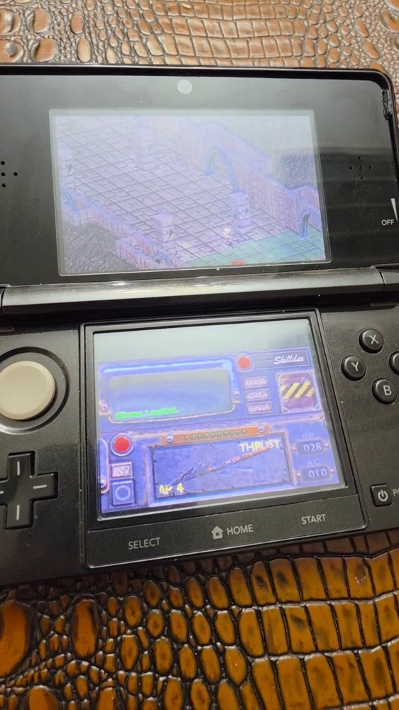
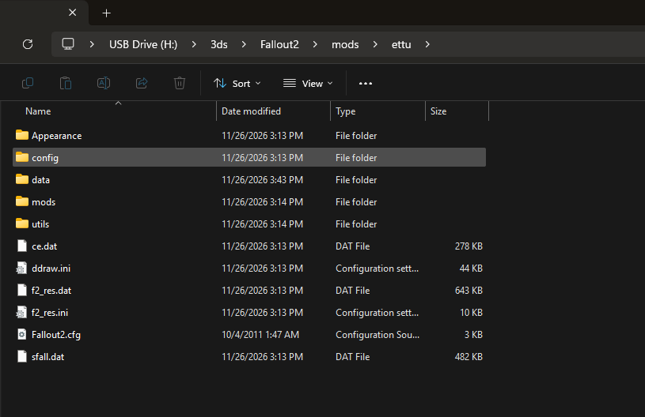
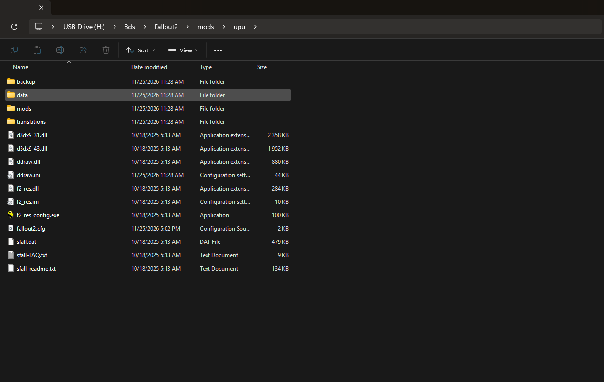

# Fallout 2 Community Edition — 3DS Enhanced

An unofficial enhanced fork of [MrHuu's Nintendo 3DS port](https://github.com/MrHuu/fallout2-ce-3ds) of [Fallout 2 Community Edition](https://github.com/alexbatalov/fallout2-ce). This fork focuses on Old Nintendo 3DS performance, dual-screen layouts, touch controls and experimental mod compatibility while retaining the original Fallout 2 gameplay.

**Recommended version:** v1.1.1 Beta — [Release downloads (CIA and 3DSX)](https://github.com/Nookitlicious/fallout2-ce-3ds/releases).

**Experimental prerelease:** [v1.2 Alpha 8](https://github.com/Nookitlicious/fallout2-ce-3ds/releases/tag/v1.2-alpha8) — initial New 2DS XL CIA testing; Old 3DS/2DS testing needed.

Previous version: [v1.1 Beta](https://github.com/Nookitlicious/fallout2-ce-3ds/releases/tag/v1.1_beta).

> Earlier builds were tested on Old 3DS hardware. Alpha 8 is experimental and has not yet been validated on Old 3DS/2DS. Back up your saves before updating or trying mods. A legally obtained copy of Fallout 2 is required; original game data is not included.

## Preview

Photos from earlier development builds running on actual 3DS hardware. Final beta layouts may differ.

<p>
  
  
  
</p>

## What's new in v1.2 Alpha 8

- Experimental Sonora and Et Tu (Fallout 1 in 2) compatibility.
- Et Tu directory-based mod loading, character creation and world map fixes.
- Native Sfall movie filename replacements for the existing 17 movie slots.
- Fixed graphical corruption during map transitions; the v1.1.1 loading overlay was removed.
- Initial New 2DS XL CIA testing successful. The 3DSX was built but not independently tested. Old 3DS/2DS testing and full campaigns remain pending.
- Known limitations: incomplete Sfall scripting, expanded movie slots, blank movie entries and subtitle compatibility. A compiler warning about possible subtitle path truncation remains.

## What's new in v1.1.1 Beta

This maintenance update focuses on world map navigation, character creation and zone transitions while retaining the performance improvements and experimental mod support from v1.1.

### World map

- Dedicated dual-screen layout with the map on the top screen and destination controls on the touchscreen by default.
- Press **SELECT** to swap the map and control panel between screens. With the map on the bottom screen, destinations can be selected directly by touch. Press SELECT again to switch back.
- Use the D-pad to pan the world map, the Circle Pad to move the cursor, and A or R to select.
- Added a fallback for location labels that display "Error": the game uses the configured area name from `city.txt` when a localized name is unavailable in `map.msg`.
- Added gameplay layout restoration when leaving the world map or entering encounters.

### Character creation

- Dedicated touchscreen layout for the Options popup to address clipping.
- Added D-pad scrolling alongside Circle Pad scrolling on the character screen.
- Press **B** to close the Options popup or character file dialog.
- Improved character save/load dialog layout and restoration of the character screen.

### Zone loading

- Added a native "LOADING AREA..." / "Please wait..." display during area loading, independent of the game's palette fades and without an intentional loading delay.

### Testing status

The initial redesigned world map was confirmed working on physical Old 3DS hardware. The remaining changes, including screen swapping, area-name fallback, character dialogs and zone loading, have been implemented but still need confirmed hardware results for the final v1.1.1 build. Full playthroughs and mod regression testing are still pending. Report any issues with the console model, build format (CIA or 3DSX), and active mod profile.

## Improvements introduced in v1.1 Beta

### Performance and stability

- Old 3DS rendering, map loading, save/loading and memory-management optimizations.
- Reduced unnecessary processing and improved artwork caching.
- Artwork and heap safety checks, including a fix for a reproduced Nevada gameplay crash.
- Improved shutdown cleanup and mod startup diagnostics.

### Interface and controls

- Redesigned main menu with power armor artwork filling the top screen and dedicated bottom-screen menu buttons.
- Improved dialogue text readability, clipping, and touchscreen response selection.
- Improved inventory, character, skill selection and Automap layouts.
- Redesigned Pip-Boy with separate content and controls, automatic cursor positioning, D-pad and Circle Pad navigation.
- Improved touch mappings, physical navigation and message boxes.
- Saving/loading indicators and fixes for software keyboard input, character names and save descriptions.
- Changes intended to restore the adapted interface after movies and map transitions; additional regression testing is needed.

### Experimental mods

- Mod profile manager accessible from the main menu's Options screen.
- Shared base game archives and experimental separate save profiles.
- Initial compatibility with Unofficial Patch Updated (UPU) and Fallout: Nevada Extended.
- Recovery to vanilla after incomplete mod startup, archive loading improvements and partial native Sfall scripting support.

## Installation on Nintendo 3DS

You need a 3DS capable of running homebrew, an SD card and your own copy of Fallout 2 ([GOG](https://www.gog.com/game/fallout_2), [Steam](https://store.steampowered.com/app/38410/) or another legitimate distribution).

1. Install Fallout 2 on your PC and locate its game data.
2. Create `3ds/fallout2/` at the root of your SD card. Copy `master.dat`, `critter.dat`, `patch000.dat` (if present), the `data/` directory and any separate `sound/` directory from your installed copy. Keep a backup of your original files and saves. If copying `fallout2.cfg`, use relative paths instead of PC-specific absolute paths.
3. Download the desired CIA or 3DSX from the [Releases page](https://github.com/Nookitlicious/fallout2-ce-3ds/releases). Choose v1.1.1 Beta for the recommended build or v1.2 Alpha 8 for experimental Sonora and Et Tu support.
4. For CIA, copy it to your SD card and install using FBI on a compatible homebrew-enabled system. Launch from the HOME Menu. For 3DSX, copy the downloaded 3DSX (rename it to `fallout2-ce.3dsx`) into `3ds/fallout2/` and launch it through the Homebrew Launcher.

Example SD card layout (`sd:/` means the root of the SD card):

```text
sd:/
└── 3ds/
    └── fallout2/
        ├── fallout2-ce.3dsx     # 3DSX installation only
        ├── master.dat
        ├── critter.dat
        ├── patch000.dat         # if present in your installation
        ├── fallout2.cfg         # configuration, if present
        ├── data/
        ├── sound/               # if separate from data/
        └── mods/                # optional
```

Game content is read from the SD card for both the CIA and 3DSX; do not embed the original commercial game files into the CIA or commit them to this repository.

### Configuration

The main configuration file is `fallout2.cfg`. Ensure the archive and patch paths match the files on the SD card. Music may be under `data/sound/music/` or `sound/music/` depending on your original installation; check `music_path1` if music is missing. Keep the 3DS port's adapted display settings rather than copying desktop high-resolution settings. Windows Sfall DLLs cannot run on the 3DS.

## Installing mods

Start with a working vanilla installation before adding mods. Install the desired mod on your PC in a separate Fallout 2 folder and follow the mod author's instructions. Disable desktop-only high-resolution patches where applicable. Copy the installed mod's files into its own profile under `sd:/3ds/fallout2/mods/`, retaining the internal folder structure. Use lowercase profile names with letters, numbers, underscores or hyphens. Do not nest another installation folder inside the profile.

Example profiles:

```text
sd:/3ds/fallout2/
├── master.dat
├── critter.dat
└── mods/
    ├── upu/
    │   ├── fallout2.cfg
    │   └── ...               # UPU files and directories
    └── nevada/
        ├── Nevada.cfg        # or fallout2.cfg
        ├── Patch000.dat
        ├── Patch001.dat
        ├── sfall.dat
        ├── ddraw.ini
        ├── DATA/
        └── MODS/             # preserve installed mod resources
```

The tree is illustrative, not a complete mod manifest. Keep the mod's other configuration files, archives and resources as supplied. The profile manager can use `master.dat` and `critter.dat` from the base game folder when they are not present in the profile; a mod's own versions take precedence. The `nevada` profile recognizes `Nevada.cfg` if `fallout2.cfg` is absent. Other profiles require `fallout2.cfg`, except `sonora` in Alpha 8, which requires its own `master.dat`, `critter.dat` and `fission.dat`. Preserve any internal `mods/mods_order.txt` and the archives it references. This port does not execute Windows DLLs; full Sfall compatibility is not implemented.

### Alpha 8: Sonora and Et Tu installation

Install each mod on PC first according to its author's instructions. Keep the original Fallout 2 archives in the base SD folder.

- **Sonora:** Copy `master.dat`, `critter.dat`, `fission.dat` and `data/` from the installed Sonora folder directly into `mods/sonora/`.
- **Et Tu:** Complete the PC installation, including extracting the required original Fallout 1 assets with UNDAT as directed by the mod author. Copy `Fallout2.cfg`, `ddraw.ini`, `sfall.dat`, `ce.dat`, `f2_res.dat`, `f2_res.ini`, `data/`, `mods/`, `Appearance/` and `config/` from the installed Fallout1in2 folder into `mods/ettu/`. Keep the internal mod order file and resources. Base Fallout 2 archives can be shared from the parent game folder. Use relative archive paths (`master.dat`, `critter.dat`) in the profile configuration.
- Windows executables and DLLs shown in the examples are not required by the 3DS engine. Do not distribute commercial game assets.

### Example mod folders on SD card

These screenshots show example installed folders, not exhaustive requirements. Drive letters vary by PC.

**Sonora**


**Nevada**


**Et Tu**



**Unofficial Patch Updated**



To activate a profile:

1. Start Fallout 2 and open **Options** from the main menu.
2. Select the desired profile in the **MOD PROFILES** menu and choose **ACTIVATE**.
3. Return to the main menu and use **EXIT**.
4. Relaunch Fallout 2 to load the selected profile.
5. To return to the base game, activate `vanilla` and restart the same way.

If a mod fails to start, the port attempts to recover to vanilla on the next launch. With the game closed, you can also remove `mod-profile.txt` from `sd:/3ds/fallout2/` to reset selection. Back up your saves first; do not delete mod folders or saves as a troubleshooting step.

### Compatibility

These are preliminary results from earlier builds and Alpha 8 development. No full campaign is verified. Alpha 8 Old 3DS/2DS testing is pending.

| Game/mod | Status |
| --- | --- |
| Vanilla Fallout 2 | Initial hardware testing successful |
| Unofficial Patch Updated (UPU) | Preliminary hardware support |
| Fallout: Nevada Extended 2.0.3.4 | Initial gameplay tested in earlier builds |
| Fallout et tu (Fallout 1 in 2) | Initial New 2DS XL gameplay and movie fix tested |
| Fallout: Sonora | Initial New 2DS XL gameplay tested |
| Restoration Project, Olympus 2207, Resurrection, Yesterday | Untested; compatibility unknown |

Some Sfall features, including script hook registration/dispatch, are not implemented. Mod startup, save compatibility, interface restoration and long-term stability still require additional testing. Do not assume that a mod running on desktop Community Edition will work on 3DS.

## Build from source (CIA and 3DSX)

The 3DS target uses `Makefile.ctr`. A clean build of v1.1 Beta was successfully completed using devkitPro on Windows, producing CIA, 3DSX and ELF files. The maintainer confirmed that a freshly compiled v1.1 build worked on hardware. Alpha 8 compiled successfully using devkitPro on Windows, producing CIA and 3DSX files. A clean rebuild of Alpha 8 has not been independently verified.

### Requirements

- [devkitPro](https://devkitpro.org/) with the Nintendo 3DS development environment (devkitARM, libctru, citro2d, citro3d and the standard 3DS tools, including `tex3ds`).
- SDL2 and zlib portlibs for 3DS.
- `makerom` and `bannertool` for CIA packaging and banner/icon creation. On Windows, make sure `makerom.exe` and `bannertool.exe` are on your PATH. On Linux, the Makefile expects them in `$DEVKITPRO/tools/bin` by default (or the configured `TOOLDIR`).
- Git and GNU Make. On Windows, use the devkitPro MSYS2 shell, not plain Command Prompt.

In the devkitPro MSYS2 shell, install missing packages using the devkitPro package manager:

```sh
pacman -S --needed 3ds-dev 3ds-sdl2 3ds-zlib
```

On Linux, use `dkp-pacman` instead of `pacman` if that is how your devkitPro installation exposes its package manager. Install `makerom` and `bannertool` separately if they are not already available.

### Compile

```sh
git clone --branch mod-support https://github.com/Nookitlicious/fallout2-ce-3ds.git
cd fallout2-ce-3ds
export PATH="$DEVKITARM/bin:$DEVKITPRO/tools/bin:$PATH"
make -f Makefile.ctr clean
make -f Makefile.ctr
```

For an exact release-source build, check out the desired release tag before compiling (`git checkout v1.2-alpha8` for the experimental alpha, or `git checkout v1.1.1_beta` for the recommended beta). The expected build outputs are `fallout2-ce.cia`, `fallout2-ce.3dsx`, and `fallout2-ce.elf` (the latter is useful for crash diagnosis). The Makefile generates the RomFS texture from `os/ctr/gfx/frame_tex.t3s` and its PNG source using `tex3ds`; compiled outputs are not needed in source control. Install the compiled CIA or 3DSX and place your original game files on the SD card as described above. Keep your commercial game files outside the source checkout: the clean target deletes generated `romfs/` contents.

## Reporting bugs and contributing

Please report reproducible issues in this fork's [issue tracker](https://github.com/Nookitlicious/fallout2-ce-3ds/issues). Include the console model, build version, CIA or 3DSX format, active mod and version, reproduction steps, and any relevant crash dump or `mod-startup.log`. Do not upload copyrighted game archives or private save files publicly. Comparisons against the original 3DS port are particularly useful. The `tests/o3ds_host/` directory contains development regression-test scripts; host tests do not substitute for hardware testing.

## Credits and AI-assisted development

- [Alexander Batalov and Fallout 2 Community Edition contributors](https://github.com/alexbatalov/fallout2-ce) — original Community Edition engine.
- [MrHuu](https://github.com/MrHuu/fallout2-ce-3ds) — original Nintendo 3DS port and its platform-specific foundation.
- [Sfall contributors](https://github.com/sfall-team/sfall) — Sfall features and scripting API; this fork implements only a subset.
- The Unofficial Patch Updated, Fallout: Nevada, Fallout: Sonora and Fallout et tu development teams — their respective mods.
- Black Isle Studios and Interplay — the original Fallout 2 game.
- Nookitlicious — enhanced fork maintainer, build compilation, hardware testing, bug reproduction and release management.

### AI-Assisted Development

This project was developed through a combination of manual code modifications and AI-assisted programming using OpenAI language models.
The project maintainer actively contributed to source code editing, touchscreen mapping, interface adjustments, feature development, debugging, compilation, and extensive testing on physical Old Nintendo 3DS hardware.
AI tools were used to assist with code implementation, troubleshooting, performance optimization, and experimental mod compatibility.
This project builds upon Fallout 2 Community Edition and MrHuu's original Nintendo 3DS port.

## Upstream documentation and license

For the original project's Windows, Linux, macOS, Android and iOS instructions and general configuration information, see the [upstream Community Edition README](https://github.com/alexbatalov/fallout2-ce). Those platforms are not the focus of this fork's 3DS beta.

The source code is available under the [Sustainable Use License](LICENSE.md), with existing third-party notices and licenses retained. Original Fallout 2 game assets and separately distributed mods remain subject to their respective rights and licenses.
