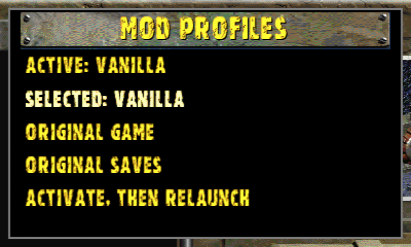
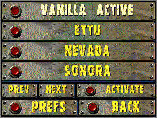
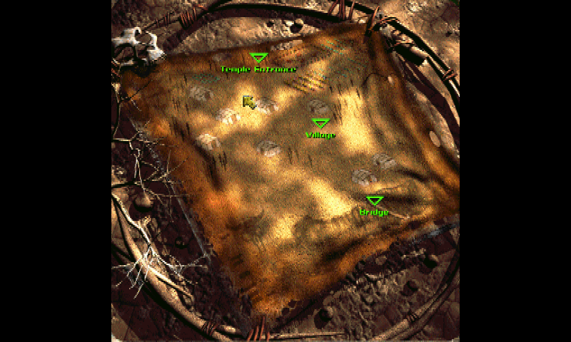
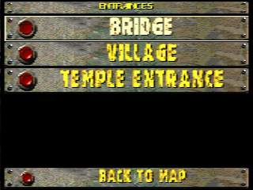

# Fallout 2 CE for Nintendo 3DS — v2.0 Beta 1

After 17 alpha builds, the next major beta is here. This release brings the dual-screen interface, world map controls, Old 3DS optimizations and experimental mod support together in one build.

Fallout et tu and Fallout: Sonora are now confirmed working in my Old 3DS testing. The world map D-pad controls also passed testing.

### Dual-screen interface and controls

- Full-width main-menu power armor artwork with dedicated bottom-screen menu buttons.
- Original Fallout-style metal menus, red indicator lights and larger readable buttons for mod profiles and town entrances.
- Improved dialogue layout, reply text clipping, touch response selection and dialogue review controls.
- Adapted inventory, item use, looting, barter, Skilldex, character creation, perks and Automap layouts.
- Improved character Options and character save/load dialogs; D-pad scrolling and B to dismiss dialogs.
- Dedicated Pip-Boy controls and content layout, automatic cursor placement, Circle Pad/D-pad navigation and touch controls.
- Improved save/load panels, status messages, software keyboard input, character names and save descriptions.
- Interface restoration improvements after movies, map transitions and encounters.

### World and town maps

- Enlarged destination list with readable names and larger touch targets.
- Dedicated top-screen map and bottom-screen destination controls; SELECT swaps the displays.
- D-pad now pans the world map in all four directions, with continuous scrolling when held. It no longer navigates the destination list in the world map view.
- Circle Pad moves the cursor across the map and controls; touch selects destinations. A/R selects, X enters a known location or toggles town entrances, and Y switches Town/World views.
- Free exploration of unknown areas, more reliable selection of nearby known locations and manual entry rather than automatic entry on approach.
- Dedicated town entrance menu with selectable entrance names, corresponding map markers and a return-to-map button.
- Fallback to configured city names when localized labels are missing.

### Old 3DS performance and stability

- Rendering, artwork caching, map loading, saving/loading and memory-management optimizations developed for Old 3DS.
- Reduced unnecessary processing, artwork/heap safety checks and improved GPU and shutdown cleanup.
- Map-transition graphical corruption fixes; the earlier loading overlay was removed.
- Optional gameplay, loading, menu and rendering profiling tools for diagnosing performance regressions.
- Improvements to party handling, lighting and mod startup diagnostics; full regression coverage remains incomplete.

### Experimental mod support

- Built-in mod-profile selector with paginated lists, active profile indication, activation/relaunch flow and separate profile saves.
- Shared base game archives when applicable; mod-specific archives, configuration and directory-based resource loading.
- Vanilla recovery after incomplete mod startup and improved archive/startup diagnostics.
- Initial compatibility with Unofficial Patch Updated, Fallout: Nevada Extended, Fallout et tu and Fallout: Sonora.
- Et tu directory-based loading, character creation and world map fixes; native Sfall movie filename replacements for the original 17 movie slots.
- Partial native Sfall support; Windows DLLs, complete scripting hooks, expanded movie slots, blank movie entries and subtitle compatibility are not guaranteed.

### Testing status

- Alpha 15/16: all 31 submitted interface, navigation, performance and stability checks passed.
- Alpha 17: maintainer reported world map control tests passed and Fallout et tu and Sonora working on physical Old 3DS hardware.
- No new crashes, freezes or save issues reported in those checklist tests. This does not establish that all prior Old 3DS crashes are fixed.
- Host world map layout test still fails a touch-coordinate assertion; its cause is unresolved despite successful hardware testing.
- Full campaigns, all console variants, separate 3DSX testing and exhaustive mod compatibility remain unverified for this beta.

## Screenshots

**Mod profile manager**

**Town entrance selection**

## Installation

Download the CIA or 3DSX and follow the [installation and mod setup instructions](https://github.com/Nookitlicious/fallout2-ce-3ds). Back up saves before updating. Original Fallout 2 game files are required and are not included.

Please report issues with your console model, build format, active mod and reproduction steps. Thanks to the original Community Edition and 3DS port developers and the mod teams.
